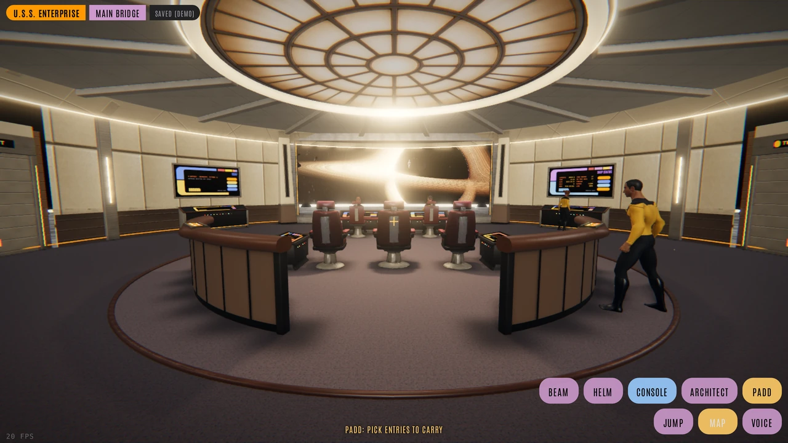

# LCARS



[](https://github.com/saftacatalinmihai/lcars/actions/workflows/c-cpp.yml)

A Star Trek console for your journal: one SQLite file, a small HTTP server
in C, and the web console and 3D deck it serves, for one person on a box of
their own.

**Try it in the browser, nothing installed:** [the demo](https://public.mihai-safta.dev/lcars-demo/index.html)
(it runs on made-up entries in your browser, and saves nothing to a server).

Built by a crew of Claude Code engineers run by an AI first officer: the
rules they work to are [CLAUDE.md](CLAUDE.md), their roles [crew/](crew/),
their seat and deploys [scripts/engineer.py](scripts/engineer.py). How it was made:
[the blog post](https://blog.mihaisafta.com/posts/lcars_journal/).

## Run it

Download the tarball for your machine from the [Releases](../../releases)
page, `lcars-X.Y.Z-linux-x86_64.tar.gz` or `lcars-X.Y.Z-linux-arm64.tar.gz`,
and `SHA256SUMS` beside it, then:

```sh
sha256sum --check --ignore-missing SHA256SUMS
tar xzf lcars-X.Y.Z-linux-x86_64.tar.gz && cd lcars-X.Y.Z-linux-x86_64
./lcars init ~/lcars-data     # a data directory, a password, lcars.env; prints the URL and login
./lcars --data ~/lcars-data   # open http://127.0.0.1:8080/ui/ and log in
```

`lcars` is one static binary: the server, the web console and the deck
inside it, and the CLI (`lcars-cli` beside it is a link to it). The
tarball also holds the crew's `scripts/` and `crew/`, this README and the
licences. `lcars init` never overwrites anything: run it again and it says
what it left alone. A new journal starts empty; you make kinds as you go,
by typing them on an entry.

## Configuration

Settings are `KEY=value` lines in `<data dir>/lcars.env`, read at start
(the real environment wins). `lcars init` writes one with the Start keys
set and every feature's key commented out with its purpose.

| Setting | What | Default |
|---|---|---|
| `--data DIR` / `LCARS_DATA_DIR` | the data directory: `lcars.db`, `lcars.env`, `media/` | the working directory |
| `--db FILE` / `LCARS_DB_PATH` | the journal itself, if not `<data dir>/lcars.db` | `<data dir>/lcars.db` |
| `--port N` / `LCARS_PORT` | the HTTP port | `8080` |
| `LCARS_BIND` | the address to listen on (`init` writes `127.0.0.1`) | all addresses |
| `LCARS_AUTH_USER`, `LCARS_AUTH_PASS` | the login (HTTP Basic auth) | none: no login asked |
| `LCARS_MEDIA_ROOT` | where photos, recordings and files go (a `media/` folder inside it) | `init` writes `<data dir>/media` |

The server speaks plain HTTP. For anything beyond this machine, keep the
password set and put a TLS proxy in front (Tailscale serve, Caddy, nginx).

## Features and what they need

Each feature is off until its settings are there; `GET /features` (as the
owner) lists each one, on or off, and what it lacks.

| Feature (`/features` name) | Needs |
|---|---|
| Media: photos, recordings, files (`media`) | a writable `LCARS_MEDIA_ROOT` |
| Cutting tapes, video posters (`media_ffmpeg`) | `ffmpeg` on PATH, or `LCARS_FFMPEG_BIN` |
| The computer: chat with your journal (`computer`) | the `claude` CLI installed and logged in (`LCARS_CLAUDE_BIN` if not on PATH); not an API key |
| The course's navigator (`navigator`) | the same `claude` CLI |
| Maps and routing for a course (`maps`) | `LCARS_MAPY_KEY` (Mapy.com); without it, OpenStreetMap tiles and no routing |
| Transcription and live voice (`transcription`) | `DEEPGRAM_API_KEY`; without it, the browser's recogniser |
| Spoken replies (`speech`) | `LCARS_TTS` and `DEEPGRAM_API_KEY` or `ELEVENLABS_API_KEY`; without it, the browser's voice |
| Search by meaning, the star chart (`embeddings`) | an OpenAI-compatible embeddings endpoint (`LCARS_EMBED_URL`, `_MODEL`, `_KEY`), e.g. llama.cpp; `LCARS_EMBED=0` keeps search to words |
| Reminders over CalDAV (`caldav`) | nothing: point the client at `/caldav/` |
| Strava (`strava`) | `LCARS_STRAVA_CLIENT_ID`, `LCARS_STRAVA_CLIENT_SECRET`, then `lcars-cli strava auth` |
| Logseq bridge (`logseq`) | `LOGSEQ_URL`, `LOGSEQ_TOKEN` |
| The engineers: Claude Code sessions that change the app (`engineers`) | `LCARS_ENGINEER=1`, `LCARS_ENGINEER_KEY`, `scripts/engineer.py`, python3, git, gh, `claude` |
| Number One (`number_one`) | `LCARS_NO1_USER`, `LCARS_NO1_PASS` (16+ characters) |
| The crew's scheduled roles and notes (`crew`) | `LCARS_CREW_USER`/`_PASS`, `LCARS_STEWARD_USER`/`_PASS`; python3, `claude`, systemd user timers (`scripts/crew.py install`) |
| Hosted reports (`reports`) | a media root, as Media |

`GET /metrics` serves Prometheus text with no setup.

Notes from another app: the engineers can design and build an import
from any notes app you keep. Logseq's is built (`lcars-cli logseq`);
Obsidian or another is one order to them away.

## Run it as a service

`~/.config/systemd/user/lcars.service`:

```ini
[Unit]
Description=LCARS
[Service]
ExecStart=%h/bin/lcars --data %h/lcars-data
Restart=on-failure
[Install]
WantedBy=default.target
```

```sh
systemctl --user enable --now lcars
loginctl enable-linger "$USER"   # keep it running after you log out
```

## An example: the author's setup

A small VPS runs the server on `127.0.0.1` with no public port;
`tailscale serve` gives it HTTPS on the tailnet. Media lives on a Synology
NAS, mounted over NFS. The crew runs on systemd user timers, and an iPhone
logs entries through the Apple Shortcuts (`shortcuts/generate.py --url`
builds them for your server). Its `lcars.env`, with placeholders:

```sh
LCARS_AUTH_USER=<you>
LCARS_AUTH_PASS=<a long password>
LCARS_PORT=8080
LCARS_BIND=127.0.0.1            # tailscale serve --bg 8080 proxies to it
LCARS_MEDIA_ROOT=/mnt/<nas>     # NFS mount of a NAS share, holding media/
LCARS_TZ=<Region/City>
DEEPGRAM_API_KEY=<key>
LCARS_MAPY_KEY=<key>
LCARS_EMBED_URL=http://127.0.0.1:8091/v1/embeddings   # scripts/lcars-embed.service
LCARS_ENGINEER=1
LCARS_ENGINEER_KEY=<random, 16+ characters>
LCARS_NO1_USER=<name>
LCARS_NO1_PASS=<random>
LCARS_CREW_USER=<name>
LCARS_CREW_PASS=<random>
LCARS_STEWARD_USER=<name>
LCARS_STEWARD_PASS=<random>
```

ARCHITECTURE.md describes how it all fits together.

## Build from source

Debian or Ubuntu:

```sh
sudo apt install build-essential libcurl4-openssl-dev libsqlite3-dev zlib1g-dev
make lcars-release    # the server, ./lcars (-O3)
make lcars-cli        # the terminal client, ./lcars-cli
make lcars-one        # the server with the CLI inside: lcars-one cli ARGS
```

`make check` compiles with every warning and writes nothing;
`lcars-ui/test/run.sh` runs the web console's tests (Node, Python and
Chromium for the slower stages). CLAUDE.md lists the rest.

The web suite runs two binaries a fresh clone lacks (ignored by git),
which `run.sh` takes from `lcars-ui/test/`:

- `lcars-ui/test/esbuild` (0.24.x): `cd lcars-ui/test && curl -fsSL https://esbuild.github.io/dl/v0.24.2 | sh`
- `lcars-ui/test/qjs` (QuickJS-ng 0.16.x): `qjs-linux-x86_64` from
  [its releases](https://github.com/quickjs-ng/quickjs/releases), renamed
  and made executable, or built from that repo (`make`, then `build/qjs`).

## Licence

MIT (LICENSE). What it carries from others - three.js, meshoptimizer,
Leaflet, the CC0 models, and the libraries the
static binary links - is listed with each licence in
THIRD_PARTY_NOTICES.md.

Not affiliated with Paramount or CBS. LCARS and Star Trek are their
trademarks.
